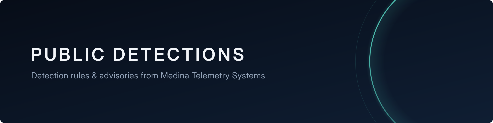

# Public Detections

Detection rules and vulnerability advisories for newly disclosed and actively exploited vulnerabilities, from
**[Medina Telemetry Systems](https://github.com/Medina-Telemetry-Systems)**.

Every rule here comes with its rationale, the source evidence it is based on, false-positive notes, and test evidence
showing it fires on the attack and stays silent on normal activity. When the public information isn't concrete enough
for a reliable rule, we publish an advisory instead of guessing.

## Index

<!-- feed:start -->
**14 rules** and **13 advisories**, newest first.

| Date | CVE | Issue | Type | Severity | Status | Details |
|:--|:--|:--|:--|:--|:--|:--|
| 2026-11-12 | CVE-2026-67449 | Portabase lets anyone overwrite its master encryption key through an upload header | Suricata | CVSS 3.1: 9.8 Critical | experimental | [card](cards/cve-2026-67449.md) |
| 2026-11-12 | CVE-2026-126768 | OpsTree REMS lets anyone log in as admin by setting an "is_local_auth" flag | Suricata | CVSS 3.1: 9.8 Critical | experimental | [card](cards/cve-2026-126768.md) |
| 2026-11-12 | CVE-2026-126259 | FortiOS high-availability clusters can be taken over with crafted HA packets | Advisory | CVSS 3.1: 9.8 Critical | advisory | [advisory](advisories/cve-2026-126259.md) |
| 2026-11-12 | CVE-2026-124814 | Ultimate Addons for Elementor Forms (WordPress) lets anyone upload a PHP file and take over the site | Advisory | CVSS 3.1: 9.8 Critical | advisory | [advisory](advisories/cve-2026-124814.md) |
| 2026-11-12 | CVE-2026-110697 | Red Hat Quay leaks other tenants' robot-account tokens through an underscore in a namespace name | Advisory | CVSS 3.1: 9.9 Critical | advisory | [advisory](advisories/cve-2026-110697.md) |
| 2026-11-11 | CVE-2026-20320 | Cisco BroadWorks reads attacker-chosen files through XML external entities in OCI-P messages | Suricata | CVSS 3.1: 7.5 High | experimental | [card](cards/cve-2026-20320.md) |
| 2026-11-11 | CVE-2026-125350 | Chrome and other Chromium browsers can run attacker code from a crafted web page (XML use-after-free) | Advisory | CVSS 3.1: 8.8 High | advisory | [advisory](advisories/cve-2026-125350.md) |
| 2026-11-11 | CVE-2026-124194 | Microsoft Outlook spoofing because a risky action happens without warning the user | Advisory | CVSS 3.1: 6.5 Medium | advisory | [advisory](advisories/cve-2026-124194.md) |
| 2026-11-11 | CVE-2026-116606 | Barracuda Email Security Gateway lets anyone with access to the admin interface import a configuration without logging in | Advisory | CVSS 3.1: not yet scored | advisory | [advisory](advisories/cve-2026-116606.md) |
| 2026-11-11 | CVE-2026-111560 | Barracuda appliances run attacker commands as root through the timezone setting | Advisory | CVSS 3.1: not yet scored | advisory | [advisory](advisories/cve-2026-111560.md) |
| 2026-11-10 | CVE-2026-125086 | D-Link M60 mesh router's MQTT broker accepts a hard-coded admin/admin login | Suricata | CVSS 3.1: 10.0 Critical | experimental | [card](cards/cve-2026-125086.md) |
| 2026-11-10 | CVE-2026-123218 | IBM Aspera Faspex lets a logged-in user become a full administrator | Advisory | CVSS 3.1: 9.8 Critical | advisory | [advisory](advisories/cve-2026-123218.md) |
| 2026-11-10 | CVE-2026-123158 | OpenSSH password login bypass ("SSHole") on some Linux systems built without PAM | Advisory | CVSS 3.1: 8.1 High | advisory | [advisory](advisories/cve-2026-123158.md) |
| 2026-11-10 | CVE-2026-116779 | FreeSWITCH runs API commands sent in a SIP chat MESSAGE addressed to "api+" | Suricata | CVSS 3.1: 9.8 Critical | experimental | [card](cards/cve-2026-116779.md) |
| 2026-11-10 | CVE-2026-102895 | GPUStack grants admin to anyone whose request looks like it came from localhost | Sigma, Suricata | CVSS 3.1: 9.8 Critical | experimental | [card](cards/cve-2026-102895.md) |
| 2026-11-09 | CVE-2026-124580 | Feiyuxing VW2100 / VEC10GP command injection via the WeChat Wi-Fi login "extend" value | Suricata | CVSS 3.1: 10.0 Critical | experimental | [card](cards/cve-2026-124580.md) |
| 2026-11-09 | CVE-2026-124560 | D-Link DIR-878 router heap overflow via the "uid" value in the CAPTCHA settings call | Advisory | CVSS 3.1: 9.8 Critical | advisory | [advisory](advisories/cve-2026-124560.md) |
| 2026-11-08 | CVE-2026-124058 | TOTOLINK CA300-PoE buffer overflow via an oversized "ApCliKeyStr" repeater password | Suricata | CVSS 3.1: 9.1 Critical | experimental | [card](cards/cve-2026-124058.md) |
| 2026-11-08 | CVE-2026-124057 | TOTOLINK CA300-PoE buffer overflow via an oversized "Key1Str1" Wi-Fi key | Suricata | CVSS 3.1: 9.1 Critical | experimental | [card](cards/cve-2026-124057.md) |
| 2026-11-08 | CVE-2026-123614 | imgproxy heap overflow from an ICO image that lies about its size | Advisory | CVSS 3.1: 9.8 Critical | advisory | [advisory](advisories/cve-2026-123614.md) |
| 2026-11-08 | CVE-2026-122041 | Checkout Field Editor for WooCommerce (Pro) lets anyone delete site media files | Advisory | CVSS 3.1: 9.1 Critical | advisory | [advisory](advisories/cve-2026-122041.md) |
| 2026-11-07 | CVE-2026-71495 | Wanderer trail app lets anyone make the server fetch internal addresses (SSRF) | Suricata | CVSS 3.1: 10.0 Critical | experimental | [card](cards/cve-2026-71495.md) |
| 2026-11-07 | CVE-2026-19868 | SonicWall SSL-VPN lets some users skip SAML login and MFA | Advisory | CVSS 3.1: 7.5 High | advisory | [advisory](advisories/cve-2026-19868.md) |
| 2026-11-07 | CVE-2026-123966 | Tenda AC19 router heap overflow via an oversized "deviceId" in parental controls | Suricata | CVSS 3.1: 10.0 Critical | experimental | [card](cards/cve-2026-123966.md) |
| 2026-11-07 | CVE-2026-123958 | TOTOLINK CA300-PoE buffer overflow via oversized LAN DNS or language settings | Suricata | CVSS 3.1: 9.9 Critical | experimental | [card](cards/cve-2026-123958.md) |
| 2026-11-07 | CVE-2026-123957 | TOTOLINK CA300-PoE buffer overflow via an oversized "ipStart" setting | Suricata | CVSS 3.1: 9.9 Critical | experimental | [card](cards/cve-2026-123957.md) |
| 2026-11-07 | CVE-2026-118066 | LatePoint WordPress booking plugin account takeover with "IS NOT NULL" | Sigma | CVSS 3.1: 9.1 Critical | experimental | [card](cards/cve-2026-118066.md) |
<!-- feed:end -->

## What's inside

| Folder | Contents |
|---|---|
| [`advisories/`](advisories/) | Plain-English advisories for important vulnerabilities, especially ones that are actively exploited but have no published technical details yet |
| [`rules/`](rules/) | Detection rules: `sigma/`, `suricata/`, `yara/` |
| [`cards/`](cards/) | One **rule card** per vulnerability: what the rule detects and why, the quoted source evidence, false-positive notes, test results, ATT&CK mapping, and what is still uncertain |
| [`tests/`](tests/) | The harmless test samples each rule was proven against (`match*` must alert, `nomatch*` must stay silent) |
| [`docs/`](docs/) | [How we test](docs/how-we-test.md) and our [publishing policy](docs/release-policy.md) |

**Start with a card.** Two examples show the range:

- [`cards/cve-2026-118066.md`](cards/cve-2026-118066.md): a **Sigma** rule for web-server logs, with ready-to-use Splunk, Microsoft Sentinel and Elastic queries
- [`cards/cve-2026-123966.md`](cards/cve-2026-123966.md): a **Suricata** network rule

## Rule status levels

| Status | Meaning |
|---|---|
| `experimental` | Passed automated validation: syntax, it fires on the attack sample, and it stays silent on normal samples. Samples are built from the published advisory or proof of concept. |
| `test` | Also proven in a lab against the real vulnerable software or realistic traffic. |
| `stable` | In use for a period without problems. |

Severity is always the **CVSS v3.1** base score from NVD.

## Using these rules

- **Sigma:** convert with [sigma-cli](https://github.com/SigmaHQ/sigma-cli) for your SIEM, or use the ready-made queries in the rule's card. Map field names to your log source.
- **Suricata:** add the `.rules` file to your rule set and reload Suricata. Rules use `$HOME_NET` and `$EXTERNAL_NET`.
- **Network rules only see clear text.** HTTPS traffic must be decrypted, or the sensor placed behind TLS termination.
- **Test in your own environment first,** especially anything marked `experimental`. Each card's false-positive notes
  say what to watch for.

Feedback is welcome. If a rule misses a variant or fires on normal traffic, please open an issue.

## License

Rules are licensed under the [Detection Rule License (DRL) 1.1](LICENSE.md). You may use, share and modify them,
including commercially, as long as you keep the author attribution (the `MTS` prefix in alert names and the author
metadata) and a link to the source.

**Provided as-is, without warranty.** No detection rule catches every variant of an attack. Use these as one layer of
your defenses.
